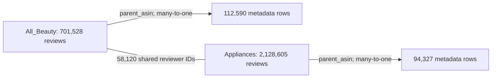

# Phase 1 Work Report: Data Provenance and Structural Audit

## Amazon Reviews'23 — All_Beauty and Appliances, with product metadata

**Report date:** 21 October 2026  
**Evidence run:** 2026-10-21T08:31:29.714135+00:00  
**Scope:** the first two Phase 1 requirements: data provenance and data structure.  
**Audience:** a reader who is beginning to work with real-world review data.

## Executive overview

This work examined four local files: the review file and the product-metadata file for each of two Amazon Reviews'23 categories, All_Beauty and Appliances. The audit read every line of these files. It did not sample review rows, remove records, train a model, or build the final prediction dataset.

The files contain **701,528 All_Beauty reviews**, **2,128,605 Appliances reviews**, **112,590 All_Beauty metadata records**, and **94,327 Appliances metadata records**. Both review files have ten top-level fields. The All_Beauty metadata file has fourteen. The Appliances metadata file has sixteen different field names across the whole file, although only five records contain all sixteen.

Every review has a matching metadata record through `parent_asin`. The metadata key is complete and unique in both files. Consequently, a correctly specified review-to-metadata join would preserve the number of review rows. The categories share 58,120 reviewer IDs but no equal `asin` or `parent_asin` values in their review files.

The audit also documents an essential distinction: these are **observational, collected review data**. A review row is not a count of every purchase. Reading the complete local files does not establish that all Amazon reviews were collected. The actual download date and exact upstream revision remain unknown and are explicitly recorded as such.

## 1. Evidence used and how the report can be checked

### 1.1 Four evidence sources

1. **The user's pasted terminal text.** This begins partway through the Appliances metadata `details` output. It contains the end of the nested-field results, category frequencies, both join summaries, overlap results, configuration, and runtime information.
2. **The complete saved audit JSON.** This provides the earlier sections missing from the paste, including the file inventories, schemas, identifiers, and time ranges.
3. **The exact audited source code.** A copy of the executed `Phaseone_Partone.py` was located. Its SHA-256 matches the code hash recorded by the audit.
4. **Official dataset documentation.** This supplies the documented origin and collection method. These facts cannot be inferred from row counts alone.

The report keeps these evidence types separate. A collector's statement about collection is a documented source fact. A count calculated from the local JSONL files is a measured result. A methodological implication is an interpretation of those facts.

### 1.2 Evidence checks

| Check | Finding |
|---|---|
| Executed code version | Preserved source SHA-256 equals the hash in the runtime result and paste. |
| Full terminal versus JSON | Source, mapping, and temporal JSON blocks match for all four datasets. |
| Pasted nested-field results | All 449 available rows match the complete saved JSON. |
| Pasted join results | Both join objects match exactly; matched and unmatched counts reconcile. |
| Counting checks | All per-record widths sum to the object totals; monthly counts sum to review totals. |

All **449 nested-field rows** available in the new paste matched the saved JSON. Both pasted join objects also matched exactly. The pasted code hash matched the recorded runtime hash, and the preserved source-code copy has that same hash. The saved full terminal transcript was checked against the principal JSON results as well.

The complete terminal and JSON snapshots are preserved with this report. No fresh raw-data audit was necessary to write it. The report describes the recorded run rather than presenting later interpretation as a newly executed experiment.

### 1.3 A simple reading rule

Each results section follows the same sequence:

**Question → code that answers it → terminal result → meaning → limit of the conclusion.**

Code references point to the preserved source copy, so their line numbers remain stable. Terminal references point to the preserved full transcript, not just the incomplete paste. The companion appendix explains individual fields, monthly rows, and nested paths.

## 2. Data provenance: where the data came from

### 2.1 Published source and local files

**Question.** Which dataset is being studied, and which local files were actually examined?

**Code.** [DATA_DIR and DATASETS](</Users/parsaanvari/Documents/ChatGPT/Data Analysis Project/reports/phase1/source_structure_report_en/evidence/audited_source.py:38>) define the local paths. [input_path()](</Users/parsaanvari/Documents/ChatGPT/Data Analysis Project/reports/phase1/source_structure_report_en/evidence/audited_source.py:563>) resolves them. [provenance_context()](</Users/parsaanvari/Documents/ChatGPT/Data Analysis Project/reports/phase1/source_structure_report_en/evidence/audited_source.py:491>) records the published source context. [audit_file()](</Users/parsaanvari/Documents/ChatGPT/Data Analysis Project/reports/phase1/source_structure_report_en/evidence/audited_source.py:301>) obtains each file's size, hash, format, and audit timestamps.

**Terminal evidence.** [GLOBAL section 1](</Users/parsaanvari/Documents/ChatGPT/Data Analysis Project/reports/phase1/source_structure_report_en/evidence/terminal_report.txt:15>) and each dataset's `[A] FILE PROVENANCE` section. Machine-readable paths: `provenance_context` and `datasets[].source`.

The declared published source is **Amazon Reviews'23**, collected by **McAuley Lab**. The [official dataset page](https://amazon-reviews-2023.github.io/) is the source reference, and the McAuley Lab Hugging Face repository is recorded as a published file location. The actual audited inputs are:

| Local file | Recorded path | Stored bytes |
|---|---|---|
| All_Beauty | `/Users/parsaanvari/Downloads/DataAnalysis/All_Beauty.jsonl` | 326,611,506 |
| meta_All_Beauty | `/Users/parsaanvari/Downloads/DataAnalysis/meta_All_Beauty.jsonl` | 212,990,142 |
| Appliances | `/Users/parsaanvari/Downloads/DataAnalysis/Appliances.jsonl` | 929,451,412 |
| meta_Appliances | `/Users/parsaanvari/Downloads/DataAnalysis/meta_Appliances.jsonl` | 285,298,475 |

**Meaning.** These exact files, rather than the whole Amazon Reviews'23 release, form the scope of this work. The two remaining project categories are outside the present audit. A filename records membership in a selected source file; it is not a substitute for checking the category labels stored inside metadata.

**Limit.** The published candidate URL is a reference location. The audit did not retrieve that remote file and compare it with an authoritative remote checksum. It therefore documents the declared source and the exact local version without claiming a fully verified download chain.

### 2.2 Collection method

**Code.** [provenance_context()](</Users/parsaanvari/Documents/ChatGPT/Data Analysis Project/reports/phase1/source_structure_report_en/evidence/audited_source.py:491>) records `collection_method`, the source URLs, and the limitations. This is a documentation step: the script does not reconstruct the original crawl.

**Terminal evidence.** [GLOBAL section 1](</Users/parsaanvari/Documents/ChatGPT/Data Analysis Project/reports/phase1/source_structure_report_en/evidence/terminal_report.txt:15>), especially `collection_method` and `limits`.

The authors describe a **user-centred collection process**: user identifiers were selected from public Amazon pages, and review pages associated with those users were collected. They explain that the resulting history for an item may be incomplete when some reviewers are outside the collected user pool. Reviews posted near the end of collection can also be missing before the nominal cutoff. These statements come from [Appendix B of the official paper](https://arxiv.org/html/2403.03952v2#A2).

**Meaning.** The collected users determine which item reviews enter the dataset. This makes the source useful for studying recorded interactions, but does not establish a random sample of every buyer or every product. No sampling probability for each local review is available in these files.

### 2.3 Observational data, not a controlled experiment

**Code and terminal.** [provenance_context()](</Users/parsaanvari/Documents/ChatGPT/Data Analysis Project/reports/phase1/source_structure_report_en/evidence/audited_source.py:491>) and `data_design` in [GLOBAL section 1](</Users/parsaanvari/Documents/ChatGPT/Data Analysis Project/reports/phase1/source_structure_report_en/evidence/terminal_report.txt:15>) explicitly identify the data as observational.

Users made their own choices about products, review writing, ratings, and helpful votes. Researchers did not randomly assign people to products or hold their experiences constant. A controlled experiment would deliberately assign conditions—for example, randomly showing two groups different product descriptions—and compare outcomes under that design. The files do not represent such an experiment.

**Meaning.** The data can support descriptions and carefully evaluated predictions. A relationship between a product attribute and a low rating does not by itself show that the attribute caused the low rating. Other differences between products and reviewers may explain part of the relationship.

### 2.4 Units of observation

**Code.** The `kind` branch in [audit_file()](</Users/parsaanvari/Documents/ChatGPT/Data Analysis Project/reports/phase1/source_structure_report_en/evidence/audited_source.py:301>) distinguishes review records from metadata records. Separate `REVIEW_SCHEMA` and `META_SCHEMA` definitions give them different meanings. [IdentifierIndex.identifiers()](</Users/parsaanvari/Documents/ChatGPT/Data Analysis Project/reports/phase1/source_structure_report_en/evidence/audited_source.py:204>) checks whether the metadata product key is unique.

**Terminal evidence.** `observation_units` in [GLOBAL section 1](</Users/parsaanvari/Documents/ChatGPT/Data Analysis Project/reports/phase1/source_structure_report_en/evidence/terminal_report.txt:15>); dataset `[B]`, `[C1]`, and `[D]` sections.

| Level | What one record means | What it does not establish |
|---|---|---|
| Review file | One collected review record associated with a reviewer and product IDs. | One guaranteed distinct purchase, or all purchases of that product. |
| Metadata file | One collected product-information record. In these files its parent ID was found to be unique. | A historical sequence of changes to the product page. |
| Later prediction dataset | One parent product at the chosen early-review decision point. | An object already created by this structural audit. |

The third row explains the relationship to the wider project; this audit did not yet assemble the five-review inputs and ten-review outcomes.

### 2.5 Main limitations of data generation

| Documented issue | What it means for this analysis | Code/output connection |
|---|---|---|
| Self-selected review writing | People who post reviews may differ from people who do not. A review average is not automatically an all-buyer average. | provenance_context.limits |
| Incomplete product review coverage | The first collected review need not be the first actual review; uncollected reviews can affect observed histories. | collection_method and limits |
| Unequal opportunity to receive helpful votes | Older or more visible reviews can accumulate more votes. No impression or vote-event history is supplied by these files. | limits; helpful_vote field definition |
| Crawl-time metadata snapshot | Current product information is not a versioned record of what was known at an earlier review date. | limits; metadata temporal status |
| Review and purchase are different units | Collected rows do not count all purchases, returns, or defects. | observation_units; limits |
| Category scope and labels | Selected files are not a random representation of all Amazon products; main_category is a separate label. | assigned_categories; main_category_counts |
| Purchase verification is not a fraud label | False does not prove a review is fake; True does not remove self-selection. | verified_purchase schema; methodological interpretation |

These limitations are documented to define the population and the strength of possible conclusions. The audit has not estimated the size of each bias. For example, self-selection is a methodological concern; the results do not quantify how much a particular rating average differs from the opinions of all buyers.

### 2.6 Local version, file times, and unknown download facts

**Code.** [sha256_file()](</Users/parsaanvari/Documents/ChatGPT/Data Analysis Project/reports/phase1/source_structure_report_en/evidence/audited_source.py:134>) calculates SHA-256 over the stored bytes. [audit_file()](</Users/parsaanvari/Documents/ChatGPT/Data Analysis Project/reports/phase1/source_structure_report_en/evidence/audited_source.py:301>) records local file information before and after reading, and only records download facts when independently supplied.

**Terminal evidence.** Dataset `[A]` sections; `sha256_stored_bytes`, `filesystem_mtime_utc_not_download_date`, and the three nullable download fields.

| Dataset | Local SHA-256 |
|---|---|
| All_Beauty | `36ca7c48440a8247b2dca0174d095238422b506a8a80c114dca722b7715f1c94` |
| meta_All_Beauty | `1cfbdf6d2ccf9c3ac52a4508b15f31f8f340508a245b65c3e3b5f461e06e97ef` |
| Appliances | `d9dd03aa9be0c8e6fea66d8ce99a7e5b359e272d6323186c1aa80f6d36af1dab` |
| meta_Appliances | `b25ae892af7bc452c4a54b7e4fee52f4c3e9adf058768ca3cb07ecb8d328b41e` |

A SHA-256 value acts as a file fingerprint. If the hash changes in another run, the input bytes changed. This is useful for reproducibility, but it does not certify that a file is an official release unless it is compared with a trusted reference.

For every file, `actual_download_url`, `actual_downloaded_at_utc`, and `source_revision` are `null`. Here, `null` means **not established by the available evidence**. It does not mean that no download happened. The file-system modification time is recorded separately and is not presented as the download date or the crawl date.

`local_file_unchanged_during_audit=True` means the file size and modification-time values were unchanged between the beginning and the end of reading. This is a practical check of file state, not an independent proof that the source collection was complete.

## 3. How the code read and counted the records

**Code.** [audit_file()](</Users/parsaanvari/Documents/ChatGPT/Data Analysis Project/reports/phase1/source_structure_report_en/evidence/audited_source.py:301>) reads each file line by line, decodes UTF-8, parses JSON, and verifies that the parsed value is an object—a dictionary of named fields. [reject_non_json_constant()](</Users/parsaanvari/Documents/ChatGPT/Data Analysis Project/reports/phase1/source_structure_report_en/evidence/audited_source.py:103>) rejects non-standard literal constants such as `NaN`. [run()](</Users/parsaanvari/Documents/ChatGPT/Data Analysis Project/reports/phase1/source_structure_report_en/evidence/audited_source.py:723>) runs the four file audits in sequence.

**Terminal evidence.** [GLOBAL section 2](</Users/parsaanvari/Documents/ChatGPT/Data Analysis Project/reports/phase1/source_structure_report_en/evidence/terminal_report.txt:42>) and every dataset's `[B] RECORD STRUCTURE` section.

| Dataset | Lines scanned | JSON objects | Blank lines | Unreadable/invalid JSON | Non-object JSON | Complete |
|---|---|---|---|---|---|---|
| All_Beauty | 701,528 | 701,528 | 0 | 0 | 0 | True |
| meta_All_Beauty | 112,590 | 112,590 | 0 | 0 | 0 | True |
| Appliances | 2,128,605 | 2,128,605 | 0 | 0 | 0 | True |
| meta_Appliances | 94,327 | 94,327 | 0 | 0 | 0 | True |

All recorded line-error counts are zero. Every scanned line was therefore counted as a JSON object in this run. `max_lines=null` means no debugging cap was configured, and `complete=True` confirms that the end of each local file was reached with unchanged file-state checks.

**Meaning.** The results describe full local files rather than a preview of their first few records. Large files were processed without loading a full review DataFrame into memory. Exact identifier counts were stored in a temporary SQLite index in bounded batches.

**Limit.** Readable JSON is not the same as a fully valid business record. This stage does not establish every rating's allowed value, detect all duplicate reviews, or check every URL on the network. No reported count should be read as a post-cleaning count.

## 4. Top-level structure: rows, columns, and variable record widths

**Code.** In [audit_file()](</Users/parsaanvari/Documents/ChatGPT/Data Analysis Project/reports/phase1/source_structure_report_en/evidence/audited_source.py:301>), `objects += 1` counts records, `key_widths[len(record)] += 1` counts fields per record, and the observed field names determine the column union.

**Terminal evidence.** `[2] FILE OVERVIEW`; dataset `[B]` values `object_rows`, `observed_column_union_count`, and `keys_per_record_distribution`.

| Dataset | Object rows | Observed field-name union | Fields-per-record distribution | Terminal evidence |
|---|---|---|---|---|
| All_Beauty | 701,528 | 10 | {"10": 701528} | [All_Beauty section B](</Users/parsaanvari/Documents/ChatGPT/Data Analysis Project/reports/phase1/source_structure_report_en/evidence/terminal_report.txt:72>) |
| meta_All_Beauty | 112,590 | 14 | {"14": 112590} | [meta_All_Beauty section B](</Users/parsaanvari/Documents/ChatGPT/Data Analysis Project/reports/phase1/source_structure_report_en/evidence/terminal_report.txt:464>) |
| Appliances | 2,128,605 | 10 | {"10": 2128605} | [Appliances section B](</Users/parsaanvari/Documents/ChatGPT/Data Analysis Project/reports/phase1/source_structure_report_en/evidence/terminal_report.txt:1052>) |
| meta_Appliances | 94,327 | 16 | {"14": 94322, "16": 5} | [meta_Appliances section B](</Users/parsaanvari/Documents/ChatGPT/Data Analysis Project/reports/phase1/source_structure_report_en/evidence/terminal_report.txt:1421>) |

### 4.1 What “sixteen columns” means for Appliances metadata

The Appliances metadata result is `{14: 94322, 16: 5}`. Thus 94,322 records have fourteen fields, while five records have sixteen. The file contains sixteen different top-level names overall; it does **not** contain sixteen populated fields in every record.

The extra fields are `author` and `subtitle`:

| Field | Absent key | Explicit null | Observed non-null type/count |
|---|---|---|---|
| author | 94,322 | 4 | {"object": 1} |
| subtitle | 94,322 | 0 | {"string": 5} |

`author` contains an object in one record and an explicit null in four. It is absent from the other records. `subtitle` is a string in the five records where it appears. These are observed additions to the standard audit schema. The script marks their role as `undocumented`, which means outside the predefined field contract—not automatically invalid or corrupt.

The type-mismatch count for an extra field must not be treated as a passed validation test: no expected type was specified for it. This is different from the type checks on the standard fields.

## 5. Data types and field meanings

### 5.1 Raw JSON types and analytical roles

**Code.** [raw_type()](</Users/parsaanvari/Documents/ChatGPT/Data Analysis Project/reports/phase1/source_structure_report_en/evidence/audited_source.py:84>) identifies types before pandas or another library can infer or convert them. The two schema constants assign expected non-null types and analytical roles. [audit_file()](</Users/parsaanvari/Documents/ChatGPT/Data Analysis Project/reports/phase1/source_structure_report_en/evidence/audited_source.py:301>) counts the observed types separately.

**Terminal evidence.** Each `[C1] FIELD TYPES AND MEANINGS` table and `[C2] FIELD PRESENCE` table.

The terms used by the audit have precise meanings:

| Audit term | Simple explanation |
|---|---|
| `integer` | A JSON value read as a whole-number type. |
| `number` | A JSON value read as a floating-point number, such as `5.0`. |
| `string` | Text enclosed in JSON quotation marks. |
| `boolean` | A true/false value. |
| `array` | A list that can contain zero, one, or many elements. |
| `object` | A dictionary of named keys and values. |
| `null` | An explicitly recorded missing value. |

`raw_type()` checks booleans before integers because Python otherwise treats a boolean as a kind of integer. It does not silently turn numeric strings into numbers. Type counting therefore preserves distinctions that automatic table loading could hide.

An analytical role describes how a field should be understood. A star rating is ordinal, a user ID is an identifier, and a helpful-vote value is a count. These roles are not determined solely by the computer's storage type.

### 5.2 Complete review data dictionary

Both review files contain the same ten standard fields, and their observed raw types agree.

| Field | All_Beauty raw type | Appliances raw type | Analytical meaning | Reading note |
|---|---|---|---|---|
| rating | {"number": 701528} | {"number": 2128605} | Ordinal star rating | Floating-point storage does not turn stars into a continuously measured physical quantity. |
| title | {"string": 701528} | {"string": 2128605} | Review headline | Different from a product title in metadata. |
| text | {"string": 701528} | {"string": 2128605} | Review body | A string may be blank or very short. |
| images | {"array": 701528} | {"array": 2128605} | List of user-review image descriptors | An empty list means no descriptor is recorded; elements are not separate reviews. |
| asin | {"string": 701528} | {"string": 2128605} | Variant/product identifier | Use as a label, not as a number to average. |
| parent_asin | {"string": 701528} | {"string": 2128605} | Parent-product identifier and metadata join key | The planned product-level unit uses this grouping. |
| user_id | {"string": 701528} | {"string": 2128605} | Reviewer identifier | Repeated IDs can connect observations, including across categories. |
| timestamp | {"integer": 701528} | {"integer": 2128605} | Review event time | Raw integer; converted with explicit ms and UTC. |
| helpful_vote | {"integer": 701528} | {"integer": 2128605} | Accumulated helpful-vote count | Not a complete record of review exposure or individual vote times. |
| verified_purchase | {"boolean": 701528} | {"boolean": 2128605} | Purchase-verification flag | Not a guarantee of review truth or a label of fraud. |

For these standard fields, `incompatible_nonnull_type_rows=0` in both categories. This supports the stated raw schema. It does not replace range checks or semantic checks. For example, a number can have the right type while still being outside an allowed rating range.

### 5.3 Complete metadata data dictionary

| Field | All_Beauty raw types/counts | Appliances raw types/counts | Meaning |
|---|---|---|---|
| main_category | {"string": 112590} | {"null": 4676, "string": 89651} | Product-page category label, distinct from file membership. |
| title | {"string": 112590} | {"string": 94327} | Product title, not a review headline. |
| average_rating | {"number": 112590} | {"number": 94327} | Aggregate rating shown for the product page, not necessarily the collected-review mean. |
| rating_number | {"integer": 112590} | {"integer": 94327} | Product-page rating count, distinct from local review rows. |
| features | {"array": 112590} | {"array": 94327} | List of product feature statements. |
| description | {"array": 112590} | {"array": 94327} | List of product-description elements. |
| price | {"null": 94886, "number": 17704} | {"null": 47601, "number": 46726} | Recorded product price; historical prices are not supplied. |
| images | {"array": 112590} | {"array": 94327} | List of product image descriptors. |
| videos | {"array": 112590} | {"array": 94327} | List of product video descriptors. |
| store | {"null": 11331, "string": 101259} | {"null": 916, "string": 93411} | Recorded store label. |
| categories | {"array": 112590} | {"array": 94327} | List representing category information. |
| details | {"object": 112590} | {"object": 94327} | Dictionary of variable product attributes. |
| parent_asin | {"string": 112590} | {"string": 94327} | Candidate product key, found complete and unique in these two metadata files. |
| bought_together | {"null": 112590} | {"null": 94327} | Potential bundle links; all observed values are null in both files. |
| author | Not observed | {"null": 4, "object": 1} | Extra field observed in five Appliances records; no standard type contract was applied. |
| subtitle | Not observed | {"string": 5} | Extra string field observed in five Appliances records. |

`title` means review headline in the review file and product title in metadata. Likewise, review `images` and product `images` describe different media sources. Later joins should preserve clear prefixes such as `review_title` and `product_title`.

`rating_number` is a product-page count, not an audited count of review rows in the local file. `average_rating` should not be assumed to be the average of the collected rows or the first five reviews. This distinction follows from the field meanings and the collection limits.

### 5.4 Presence, explicit nulls, and empty values

**Code.** [audit_file()](</Users/parsaanvari/Documents/ChatGPT/Data Analysis Project/reports/phase1/source_structure_report_en/evidence/audited_source.py:301>) keeps separate counters for present keys, explicit nulls, blank strings, empty arrays, and empty objects. An absent key is calculated as `object_rows - present_rows`.

**Terminal evidence.** `[C2] FIELD PRESENCE`; complete per-field results are reproduced in the English appendix.

| Example | All_Beauty | Appliances | Interpretation |
|---|---|---|---|
| Review text: blank string | 720 | 2065 | Key present and string-typed, but blank after whitespace checking. |
| Review images: empty list | 641844 | 2043656 | No image element is recorded for these review rows. |
| Metadata price: null | 94886 | 47601 | Unknown price, not a price of zero. |
| Metadata categories: empty list | 112590 | 3285 | No category-list element is recorded. |
| Metadata details: empty object | 4512 | 2010 | No attribute key/value pair is recorded. |
| Metadata bought_together: null | 112590 | 94327 | No non-null bundle relationship is available. |

These states are not interchangeable. `images: []` means a list is present but contains no image descriptor. A missing `images` key would be a different structural state. Similarly, an empty text string is not a JSON null.

The reported percentage `absent_or_null_percent` combines absent keys and explicit nulls only. Blank strings and empty containers are intentionally kept separate. For that reason it should not be described as one universal “percentage of unusable data.”

All standard review fields are present and non-null in all review rows. Nevertheless, there are 720 blank text bodies in All_Beauty and 2,065 in Appliances. This illustrates why checking only column existence would be insufficient.

## 6. Identifiers and product grouping

### 6.1 Exact identifier counts

**Code.** [IdentifierIndex.add()](</Users/parsaanvari/Documents/ChatGPT/Data Analysis Project/reports/phase1/source_structure_report_en/evidence/audited_source.py:179>) registers nonblank string identifiers. [IdentifierIndex.flush()](</Users/parsaanvari/Documents/ChatGPT/Data Analysis Project/reports/phase1/source_structure_report_en/evidence/audited_source.py:190>) updates the SQLite counts. [IdentifierIndex.identifiers()](</Users/parsaanvari/Documents/ChatGPT/Data Analysis Project/reports/phase1/source_structure_report_en/evidence/audited_source.py:204>) calculates distinct values, repeated values, and repeated occurrences.

**Terminal evidence.** [All_Beauty section D](</Users/parsaanvari/Documents/ChatGPT/Data Analysis Project/reports/phase1/source_structure_report_en/evidence/terminal_report.txt:119>), [Appliances section D](</Users/parsaanvari/Documents/ChatGPT/Data Analysis Project/reports/phase1/source_structure_report_en/evidence/terminal_report.txt:1099>), and the metadata `[D]` sections.

| Dataset | Identifier | Valid string occurrences | Distinct values | Rows without a valid value |
|---|---|---|---|---|
| All_Beauty | user_id | 701,528 | 631,986 | 0 |
| All_Beauty | asin | 701,528 | 115,709 | 0 |
| All_Beauty | parent_asin | 701,528 | 112,565 | 0 |
| meta_All_Beauty | parent_asin | 112,590 | 112,590 | 0 |
| Appliances | user_id | 2,128,605 | 1,755,732 | 0 |
| Appliances | asin | 2,128,605 | 104,237 | 0 |
| Appliances | parent_asin | 2,128,605 | 94,319 | 0 |
| meta_Appliances | parent_asin | 94,327 | 94,327 | 0 |

Every review row contains valid, nonblank string values for the three audited identifiers. Identifier strings were preserved as read rather than silently trimmed. Surrounding-whitespace counts for these identifiers are zero in this run.

The product count used for the planned parent-level analysis is the number of distinct `parent_asin` values: 112,565 and 94,319. Counting distinct `asin` values instead would count some variants separately.

### 6.2 Repeated identifiers are not duplicate reviews

| Review dataset | User IDs with more than one occurrence | Occurrences after the first for each user |
|---|---|---|
| All_Beauty | 48,433 | 69,542 |
| Appliances | 259,221 | 372,873 |

For All_Beauty, subtracting the 631,986 distinct user IDs from 701,528 review rows gives 69,542 occurrences after the first occurrence of each user ID. This is not the number of multi-review users. The latter is 48,433 IDs with count greater than one. Appliances has 372,873 later occurrences and 259,221 IDs with count greater than one.

Neither measure identifies exact duplicate review records. One user may legitimately review several products. Conversely, a repeated raw record can increase an ID's occurrence count. These are raw-file structural counts, before a dedicated duplicate-record audit.

### 6.3 Variant-to-parent mapping

**Code.** [IdentifierIndex.variant_mapping()](</Users/parsaanvari/Documents/ChatGPT/Data Analysis Project/reports/phase1/source_structure_report_en/evidence/audited_source.py:226>) counts distinct `(asin, parent_asin)` pairs and checks both directions of the mapping.

**Terminal evidence.** Dataset `[E] ASIN TO PARENT MAPPING` sections.

| Dataset | Distinct variant/parent pairs | Variants linked to multiple parents | Parents linked to multiple variants |
|---|---|---|---|
| All_Beauty | 115,709 | 0 | 995 |
| Appliances | 104,237 | 0 | 4,216 |

The results show that 995 All_Beauty parents and 4,216 Appliances parents have multiple observed variant IDs. No observed `asin` maps to multiple parent IDs within either file. This supports grouping variants under the parent ID in later product-level work.

The number of multi-variant parents is not equal to the difference between the two distinct-ID counts: a parent can contain more than two variants. The findings also do not establish a product's complete historical identity across all Amazon versions.

## 7. Temporal variables and actual review coverage

### 7.1 Timestamp conversion

**Code.** [parse_epoch()](</Users/parsaanvari/Documents/ChatGPT/Data Analysis Project/reports/phase1/source_structure_report_en/evidence/audited_source.py:118>) converts the raw value using the explicitly supplied unit. [audit_file()](</Users/parsaanvari/Documents/ChatGPT/Data Analysis Project/reports/phase1/source_structure_report_en/evidence/audited_source.py:301>) updates minimum and maximum dates, monthly counters, and reference-window flags. [parser()](</Users/parsaanvari/Documents/ChatGPT/Data Analysis Project/reports/phase1/source_structure_report_en/evidence/audited_source.py:782>) defines the default unit as `ms`.

**Terminal evidence.** [All_Beauty section F](</Users/parsaanvari/Documents/ChatGPT/Data Analysis Project/reports/phase1/source_structure_report_en/evidence/terminal_report.txt:134>), [Appliances section F](</Users/parsaanvari/Documents/ChatGPT/Data Analysis Project/reports/phase1/source_structure_report_en/evidence/terminal_report.txt:1114>), and `timestamp_unit` in the run configuration.

The unit used in this run is **milliseconds since the Unix epoch**, and the converted dates are stored in UTC. UTC gives one consistent time standard for comparing records.

The code does not automatically guess or repair a timestamp unit. Conversion with the declared millisecond unit places all values in the stated historical reference window. That is a consistency check; mere conversion success would not prove a unit was correct in an arbitrary dataset.

### 7.2 Observed time ranges

| Dataset | Earliest convertible UTC timestamp | Latest convertible UTC timestamp | Span in days |
|---|---|---|---|
| All_Beauty | 2000-11-01T04:24:18+00:00 | 2023-09-09T00:39:36.666000+00:00 | 8,346.84396604 |
| Appliances | 2000-10-23T14:37:23+00:00 | 2023-09-12T16:29:17.016000+00:00 | 8,359.07770852 |

All 701,528 All_Beauty timestamps and all 2,128,605 Appliances timestamps were convertible. All were inside the configured reference window, and none was after the run's recorded `as_of` time.

The reference interval was **1996-01-01 inclusive to 2023-10-01 exclusive**. It is a flagging interval, not the observed range. The actual earliest local records are in 2000. The audit did not assign the reference start to the data or discard rows merely to make them fit that window.

**Interpretation.** These dates measure the coverage of collected review timestamps in the local files. They do not measure purchase dates, launch dates, collection start/end dates, or complete customer activity. The first observed review is not necessarily the first review ever posted for that product.

### 7.3 Monthly coverage

**Code.** In [audit_file()](</Users/parsaanvari/Documents/ChatGPT/Data Analysis Project/reports/phase1/source_structure_report_en/evidence/audited_source.py:301>), `monthly[date.strftime("%Y-%m")] += 1` counts records by converted UTC month.

**Terminal evidence.** `[G] ALL MONTHLY COUNTS`; all 507 reported month rows appear individually in the English appendix.

| Dataset | Nonzero months | Sum of monthly rows | Highest-count month | Reviews in that month |
|---|---|---|---|---|
| All_Beauty | 265 | 701,528 | 2021-03 | 14,062 |
| Appliances | 242 | 2,128,605 | 2021-03 | 36,838 |

The sum of monthly counts equals the review-row count in each category. This checks that every convertible review time was assigned to a month. The tables list months with at least one observed record; they do not insert rows for zero-record months.

Both earliest months contain one review. The last observed month, September 2023, contains 30 All_Beauty reviews and 198 Appliances reviews. Collection coverage ends during that month. Its count should not be compared with a full month as if calendar coverage were equal.

The common highest-count month is March 2021, with 14,062 and 36,838 reviews. This describes collected-review frequency. It does not demonstrate a sales peak, a causal event, or a change in product quality.

### 7.4 Why there is no metadata time range

**Code.** The metadata branch of [audit_file()](</Users/parsaanvari/Documents/ChatGPT/Data Analysis Project/reports/phase1/source_structure_report_en/evidence/audited_source.py:301>) records `not_applicable_no_documented_review_timestamp` rather than applying the review timestamp procedure to product attributes.

**Terminal evidence.** Metadata `[F]` sections.

These metadata files do not provide a common documented crawl timestamp or a version history. A field such as `Release date` or `Year` inside `details` has a different meaning and cannot replace the review timestamp or establish when the metadata snapshot was collected.

The temporal requirement is therefore addressed by providing the measured review ranges and explicitly documenting what is unknown for metadata. Inventing a metadata date range would make the report less accurate.

## 8. Nested structure: lists and dictionaries inside records

### 8.1 Why nested counts need separate denominators

**Code.** [audit_file()](</Users/parsaanvari/Documents/ChatGPT/Data Analysis Project/reports/phase1/source_structure_report_en/evidence/audited_source.py:301>) counts list item types and child-key types. It records each container's row count, total elements or keys, and maximum length.

**Terminal evidence.** `[H1] NESTED CONTAINERS` and `[H2] ALL NESTED CHILD TYPES` for each dataset.

| Dataset | Container field | Rows with this container type | Total elements or key occurrences | Maximum in one record | List element types/counts |
|---|---|---|---|---|---|
| All_Beauty | images | 701,528 | 107,122 | 29 | {"object": 107122} |
| meta_All_Beauty | categories | 112,590 | 0 | 0 | {} |
| meta_All_Beauty | description | 112,590 | 48,557 | 152 | {"string": 48557} |
| meta_All_Beauty | details | 112,590 | 615,813 | 23 | {} |
| meta_All_Beauty | features | 112,590 | 72,554 | 13 | {"string": 72554} |
| meta_All_Beauty | images | 112,590 | 549,209 | 22 | {"object": 549209} |
| meta_All_Beauty | videos | 112,590 | 40,679 | 10 | {"object": 40679} |
| Appliances | images | 2,128,605 | 148,536 | 27 | {"object": 148536} |
| meta_Appliances | author | 1 | 3 | 3 | {} |
| meta_Appliances | categories | 94,327 | 313,138 | 5 | {"string": 313138} |
| meta_Appliances | description | 94,327 | 176,937 | 118 | {"string": 176937} |
| meta_Appliances | details | 94,327 | 1,017,607 | 56 | {} |
| meta_Appliances | features | 94,327 | 335,621 | 17 | {"string": 335621} |
| meta_Appliances | images | 94,327 | 377,110 | 25 | {"object": 377110} |
| meta_Appliances | videos | 94,327 | 200,299 | 10 | {"object": 200299} |

An image list can contain several objects for one product. Therefore, an image-child count has image objects as its denominator, not metadata records. An object such as `details` has a different interpretation: each named child key is counted once in each record where it occurs.

`total_elements_or_keys` means the sum of list lengths or dictionary key counts. It is not the number of distinct images, distinct values, or distinct field names. `max_length` is the largest list or dictionary seen in one record; it is not a word count.

### 8.2 How to read a details row

The pasted line

```text
details | object | Power Consumption | {"string": 12}
```

means that the `Power Consumption` key was observed in twelve `details` dictionaries and its value was a string on every occurrence. It does not mean “12 watts” or “twelve different values.”

Other examples are:

| Appliances details key | Observed value types/counts | Meaning of the count |
|---|---|---|
| Part Number | {"string": 64289} | Number of dictionaries containing this exact key; not the attribute value or the number of distinct values. |
| Part number | {"string": 23} | Number of dictionaries containing this exact key; not the attribute value or the number of distinct values. |
| Product Dimensions | {"string": 45806} | Number of dictionaries containing this exact key; not the attribute value or the number of distinct values. |
| Voltage | {"string": 8190} | Number of dictionaries containing this exact key; not the attribute value or the number of distinct values. |
| Wattage | {"string": 3432} | Number of dictionaries containing this exact key; not the attribute value or the number of distinct values. |
| Power Consumption | {"string": 12} | Number of dictionaries containing this exact key; not the attribute value or the number of distinct values. |
| null | {"string": 16} | Number of dictionaries containing this exact key; not the attribute value or the number of distinct values. |

A dimension or voltage represented as a string still needs unit-aware interpretation before it can be treated as a numeric measurement. This audit documents its raw type; it does not perform that later transformation.

The key `Part Number` occurs separately from `Part number`. Similarly, `Style`, `Style Modern`, and long keys containing `See more` are counted separately. These results show non-uniform naming in the extracted dictionaries. They suggest a need for later inspection, but do not by themselves justify merging keys or establish the exact cause of the naming pattern.

The line with child key `null` and `{"string": 16}` refers to a literal key named `null`. The sixteen values are strings. It is not a count of sixteen JSON null values.

### 8.3 Image and video child fields in Appliances metadata

| Container | Child key | Value types/counts | Objects with the child key | Objects missing the child key |
|---|---|---|---|---|
| images | hi_res | {"null": 38657, "string": 338449} | 377,106 | 4 |
| images | large | {"string": 377110} | 377,110 | 0 |
| images | thumb | {"string": 377106} | 377,106 | 4 |
| images | variant | {"string": 377110} | 377,110 | 0 |
| videos | title | {"string": 200299} | 200,299 | 0 |
| videos | url | {"string": 200299} | 200,299 | 0 |
| videos | user_id | {"string": 200299} | 200,299 | 0 |

For `hi_res`, 338,449 strings plus 38,657 null values equal 377,106 present keys. There are 377,110 image objects, so the key is absent in four objects. This is a concrete distinction between an absent key and a present key with a null value.

The existence of a string URL does not prove that the URL can be downloaded, that the image is unique, or that every product has a usable high-resolution image. No network accessibility test was run.

Each video child has 200,299 string occurrences, corresponding to video objects. The `user_id` inside a video descriptor is not automatically identified with the reviewer ID of a review record.

### 8.4 Unequal information availability across metadata files

`bought_together` is null in every metadata record of both categories. Thus no non-null bundle links were observed in these files. `categories` is an empty list for every All_Beauty metadata record, while 91,042 Appliances metadata records have a nonempty category list.

These findings prevent a structural mistake: a field being documented or present does not guarantee that it contains usable information. They do not prove that Amazon had no such links or categories outside the collected files.

## 9. File membership and metadata category labels

**Code.** [audit_file()](</Users/parsaanvari/Documents/ChatGPT/Data Analysis Project/reports/phase1/source_structure_report_en/evidence/audited_source.py:301>) increments `category_values` only when `main_category` is a string. Nulls remain in the per-field presence table.

**Terminal evidence.** Metadata `[I] MAIN CATEGORY VALUES` plus the `main_category` row in `[C2]`.

| Appliances metadata main_category | Records |
|---|---|
| Tools & Home Improvement | 42,694 |
| Appliances | 25,572 |
| Amazon Home | 13,915 |
| Industrial & Scientific | 5,521 |
| Other string labels combined | 1,949 |
| Null | 4,676 |

All_Beauty metadata contains 112,135 records labelled `All Beauty` and 455 labelled `Premium Beauty`. Both values are documented rather than silently forcing the label to match the filename.

Appliances metadata has 89,651 string category labels and 4,676 null labels, giving 94,327 records in total. Its largest label is `Tools & Home Improvement`, not `Appliances`. The full category-frequency list is in the appendix.

**Meaning.** The study selected a released file called Appliances. The product-page `main_category` label is a separate attribute. Filtering to the 25,572 records whose label is exactly `Appliances` would define a different subset and require its own rationale. The label difference alone does not establish that a record is misplaced.

A small number of metadata records labelled `All Beauty` inside the Appliances file also does not prove that the review files share product IDs. Category-label overlap and identifier overlap answer different questions.

## 10. Relationships between review and metadata files

### 10.1 Join key and cardinality

A **join** links rows using a shared key. **Cardinality** describes how many records can match each other. For this project, the intended relationship is many review rows to at most one metadata row for the same parent product.

**Code.** [IdentifierIndex.relationship()](</Users/parsaanvari/Documents/ChatGPT/Data Analysis Project/reports/phase1/source_structure_report_en/evidence/audited_source.py:243>) matches the counted `parent_asin` values and measures the number of possible matches. It also checks whether metadata keys are complete and unique.

**Terminal evidence.** [JOIN: All_Beauty](</Users/parsaanvari/Documents/ChatGPT/Data Analysis Project/reports/phase1/source_structure_report_en/evidence/terminal_report.txt:2737>) and [JOIN: Appliances](</Users/parsaanvari/Documents/ChatGPT/Data Analysis Project/reports/phase1/source_structure_report_en/evidence/terminal_report.txt:2761>).

| Recorded output | All_Beauty | Appliances |
|---|---|---|
| review_rows | 701528 | 2128605 |
| review_distinct_valid_parents | 112565 | 94319 |
| metadata_rows | 112590 | 94327 |
| metadata_distinct_valid_parents | 112590 | 94327 |
| metadata_parent_key_unique_and_complete | True | True |
| matched_review_parents | 112565 | 94319 |
| unmatched_review_parents | 0 | 0 |
| matched_review_rows | 701528 | 2128605 |
| unmatched_rows_with_valid_parent | 0 | 0 |
| rows_without_valid_parent | 0 | 0 |
| matched_percent_of_all_review_rows | 100.0 | 100.0 |
| matched_percent_of_valid_review_parents | 100.0 | 100.0 |
| metadata_only_parents | 25 | 8 |
| review_rows_matching_multiple_metadata_rows | 0 | 0 |
| projected_left_join_rows_no_null_key_matching | 701528 | 2128605 |
| local_files_fully_audited | True | True |

### 10.2 Meaning of each group of join results

**Metadata key:** `metadata_parent_key_unique_and_complete=True` in both categories means every metadata row has a valid parent ID and no ID is repeated. Metadata can therefore act as the one-record side of the relationship in these local files.

**Product coverage:** `matched_review_parents` equals the number of distinct valid parent IDs in reviews. `unmatched_review_parents=0`. Every observed reviewed parent has a metadata counterpart.

**Review coverage:** `matched_review_rows` equals the review-row count. `unmatched_rows_with_valid_parent=0` and `rows_without_valid_parent=0`. Coverage is therefore 100% both by product and by review row. The two percentages normally need separate reporting because a few high-volume products can dominate a row-weighted measure.

**Metadata-only products:** The 25 All_Beauty and eight Appliances metadata-only parents have no corresponding parent ID in their category's collected review file. They are not proved to have no purchases or no reviews on Amazon.

**Join expansion:** `review_rows_matching_multiple_metadata_rows=0`. No review would be duplicated through repeated metadata matches. The projected left-join row counts are 701,528 and 2,128,605, equal to the input review counts.

**Important implementation detail:** the script derives that projection from ID occurrence counts. It does not materialise and save a full joined review-and-metadata table. The result establishes structural join safety, not completion of all later data preparation.

### 10.3 Diagram of the measured relationships



Each review has one metadata match in this run. A metadata record can have zero, one, or many collected reviews. The line between the two review files represents shared reviewer IDs, not an instruction to join all their review rows together.

## 11. Cross-category overlap

**Code.** [IdentifierIndex.overlaps()](</Users/parsaanvari/Documents/ChatGPT/Data Analysis Project/reports/phase1/source_structure_report_en/evidence/audited_source.py:285>) intersects distinct ID values from the two review files.

**Terminal evidence.** [Cross-category overlap table](</Users/parsaanvari/Documents/ChatGPT/Data Analysis Project/reports/phase1/source_structure_report_en/evidence/terminal_report.txt:2785>).

| Identifier | Shared distinct values |
|---|---|
| parent_asin | 0 |
| user_id | 58,120 |
| asin | 0 |

No equal parent or variant ID appears in both review files. This is an exact identifier result; it does not independently prove that all physical products are different under every possible identity system.

The 58,120 shared reviewer IDs show that the two category populations are not completely separate at the user level. This will matter when considering dependence between observations. It is not a count of duplicated reviews, and it does not mean that the users posted identical text.

## 12. Run configuration and reproducibility

**Code.** [parser()](</Users/parsaanvari/Documents/ChatGPT/Data Analysis Project/reports/phase1/source_structure_report_en/evidence/audited_source.py:782>) defines options, [run()](</Users/parsaanvari/Documents/ChatGPT/Data Analysis Project/reports/phase1/source_structure_report_en/evidence/audited_source.py:723>) resolves them, and [save_and_display_results()](</Users/parsaanvari/Documents/ChatGPT/Data Analysis Project/reports/phase1/source_structure_report_en/evidence/audited_source.py:693>) saves and displays the completed results.

**Terminal evidence.** [RUN CONFIGURATION](</Users/parsaanvari/Documents/ChatGPT/Data Analysis Project/reports/phase1/source_structure_report_en/evidence/terminal_report.txt:2801>), [RUNTIME](</Users/parsaanvari/Documents/ChatGPT/Data Analysis Project/reports/phase1/source_structure_report_en/evidence/terminal_report.txt:2825>), and the output-path listing.

| Recorded setting | Value | Meaning |
|---|---|---|
| data_dir | null | No optional directory override was supplied. |
| timestamp_unit | ms | Explicit epoch unit used for conversion. |
| as_of option | null | No explicit time-reference override was supplied. |
| resolved audit_as_of_utc | 2026-10-21T08:31:29.714135+00:00 | Actual time reference used by the run. |
| reference_start | 1996-01-01T00:00:00+00:00 | Inclusive historical plausibility reference. |
| reference_end_exclusive | 2023-10-01T00:00:00+00:00 | Exclusive historical reference end. |
| max_lines | null | No partial-file cap. |
| batch_size | 5000 | SQLite update batching, not row sampling. |
| progress_every | 250000 | Progress-display interval, not row sampling. |
| Python | 3.14.8 (v3.14.8:8e6e75d9102, Sep 30 2026, 14:34:30) [Clang 21.0.0 (clang-2100.1.1.101)] | Recorded interpreter build. |
| Platform | macOS-26.5.2-arm64-arm-64bit-Mach-O | Recorded operating system and architecture. |
| SQLite | 3.50.4 | Recorded database library version. |
| Executed script SHA-256 | 26031e880032df811690d9a16cee946040370e7eb47a5765fb721ce2dbb0e693 | Exact source version; independently matched to the preserved code. |

The run's time reference is 2026-10-21T08:31:29.714135+00:00. The `as_of` command-line option itself is null because no explicit override was supplied; the resolved value is stored separately. These are not contradictory results.

`data_dir=null` likewise means the optional command-line override was unused. `resolved_input_files` contains the actual paths selected from `DATASETS`. The default output path is absolute, so it does not depend on the directory in which the terminal was opened.

`batch_size=5000` controls how many records are grouped for updating the temporary identifier index. `progress_every=250000` controls progress messages. Neither option selects a sample. `max_lines=null`, together with successful end-of-file checks, supports the statement that the complete local inputs were scanned.

The code hash identifies the source version used by the recorded run. The preserved source copy was checked against this value. The current working copy may have a different hash after later edits, which is why this report links to the frozen audited copy rather than assuming every local script is identical.

`FILE ISSUES=[]` means no expected file was recorded as missing. `status=complete` means the file audit finished under its configured checks. Neither statement is a universal certificate of data quality.

## 13. Direct requirement-to-code-to-result traceability

The table below addresses every requested part of the two Phase 1 requirements. “Covered” means that the relevant explanation and evidence are present. Where the source cannot establish a fact, the unknown is documented rather than invented.

| Requirement item | Code and method | Terminal/result evidence | Supported conclusion |
|---|---|---|---|
| Source | [provenance_context()](</Users/parsaanvari/Documents/ChatGPT/Data Analysis Project/reports/phase1/source_structure_report_en/evidence/audited_source.py:491>); [audit_file()](</Users/parsaanvari/Documents/ChatGPT/Data Analysis Project/reports/phase1/source_structure_report_en/evidence/audited_source.py:301>) | [GLOBAL section 1](</Users/parsaanvari/Documents/ChatGPT/Data Analysis Project/reports/phase1/source_structure_report_en/evidence/terminal_report.txt:15>); dataset [A]; source URLs and file fingerprints | Declared published origin and exact local files documented; download chain unknown. |
| Collection method | [provenance_context()](</Users/parsaanvari/Documents/ChatGPT/Data Analysis Project/reports/phase1/source_structure_report_en/evidence/audited_source.py:491>); sourced documentation | [GLOBAL section 1](</Users/parsaanvari/Documents/ChatGPT/Data Analysis Project/reports/phase1/source_structure_report_en/evidence/terminal_report.txt:15>); collection_method | User-centred collection explained and attributed. |
| Observational/controlled status | [provenance_context()](</Users/parsaanvari/Documents/ChatGPT/Data Analysis Project/reports/phase1/source_structure_report_en/evidence/audited_source.py:491>); study-design description | [GLOBAL section 1](</Users/parsaanvari/Documents/ChatGPT/Data Analysis Project/reports/phase1/source_structure_report_en/evidence/terminal_report.txt:15>); data_design | Observational data; no randomized assignment established. |
| Time coverage | [parse_epoch()](</Users/parsaanvari/Documents/ChatGPT/Data Analysis Project/reports/phase1/source_structure_report_en/evidence/audited_source.py:118>); min/max and monthly aggregation in [audit_file()](</Users/parsaanvari/Documents/ChatGPT/Data Analysis Project/reports/phase1/source_structure_report_en/evidence/audited_source.py:301>) | [All_Beauty section F](</Users/parsaanvari/Documents/ChatGPT/Data Analysis Project/reports/phase1/source_structure_report_en/evidence/terminal_report.txt:134>); [Appliances section F](</Users/parsaanvari/Documents/ChatGPT/Data Analysis Project/reports/phase1/source_structure_report_en/evidence/terminal_report.txt:1114>); metadata [F] | Measured review coverage; no invented metadata history. |
| Observation unit | Separate schemas and kind branch; [IdentifierIndex.identifiers()](</Users/parsaanvari/Documents/ChatGPT/Data Analysis Project/reports/phase1/source_structure_report_en/evidence/audited_source.py:204>) | [GLOBAL section 1](</Users/parsaanvari/Documents/ChatGPT/Data Analysis Project/reports/phase1/source_structure_report_en/evidence/terminal_report.txt:15>); [B], [C1], [D] | Review records, product records, and later prediction units distinguished. |
| Generation limitations | [provenance_context()](</Users/parsaanvari/Documents/ChatGPT/Data Analysis Project/reports/phase1/source_structure_report_en/evidence/audited_source.py:491>); source-based limits | [GLOBAL section 1](</Users/parsaanvari/Documents/ChatGPT/Data Analysis Project/reports/phase1/source_structure_report_en/evidence/terminal_report.txt:15>); limits; metadata [A]/[F] | Selection, incomplete coverage, votes, and snapshot limitations documented. |
| Rows and columns | [audit_file()](</Users/parsaanvari/Documents/ChatGPT/Data Analysis Project/reports/phase1/source_structure_report_en/evidence/audited_source.py:301>); object and record-width counters | [GLOBAL section 2](</Users/parsaanvari/Documents/ChatGPT/Data Analysis Project/reports/phase1/source_structure_report_en/evidence/terminal_report.txt:42>); dataset [B] | Full-file counts and non-uniform record widths measured. |
| Variable types | [raw_type()](</Users/parsaanvari/Documents/ChatGPT/Data Analysis Project/reports/phase1/source_structure_report_en/evidence/audited_source.py:84>); separate schemas and type counters | Dataset [C1]/[C2]; schema.csv | Raw types and analytical roles stated, including null/absent differences. |
| Identifiers | [IdentifierIndex.identifiers()](</Users/parsaanvari/Documents/ChatGPT/Data Analysis Project/reports/phase1/source_structure_report_en/evidence/audited_source.py:204>); [IdentifierIndex.variant_mapping()](</Users/parsaanvari/Documents/ChatGPT/Data Analysis Project/reports/phase1/source_structure_report_en/evidence/audited_source.py:226>) | Dataset [D]/[E]; identifiers.csv | Distinct IDs, repeated occurrences, and parent/variant relationships measured. |
| Temporal variables | [parse_epoch()](</Users/parsaanvari/Documents/ChatGPT/Data Analysis Project/reports/phase1/source_structure_report_en/evidence/audited_source.py:118>); explicit ms/UTC | Review [F]/[G]; monthly_counts.csv | Time definition, bounds, conversion and coverage explained. |
| File relationships | [IdentifierIndex.relationship()](</Users/parsaanvari/Documents/ChatGPT/Data Analysis Project/reports/phase1/source_structure_report_en/evidence/audited_source.py:243>); [IdentifierIndex.overlaps()](</Users/parsaanvari/Documents/ChatGPT/Data Analysis Project/reports/phase1/source_structure_report_en/evidence/audited_source.py:285>) | [JOIN: All_Beauty](</Users/parsaanvari/Documents/ChatGPT/Data Analysis Project/reports/phase1/source_structure_report_en/evidence/terminal_report.txt:2737>); [JOIN: Appliances](</Users/parsaanvari/Documents/ChatGPT/Data Analysis Project/reports/phase1/source_structure_report_en/evidence/terminal_report.txt:2761>); [Cross-category overlap table](</Users/parsaanvari/Documents/ChatGPT/Data Analysis Project/reports/phase1/source_structure_report_en/evidence/terminal_report.txt:2785>) | Key completeness, many-to-one safety, coverage and overlaps established locally. |
| Recommended diagram | [build_readable_report()](</Users/parsaanvari/Documents/ChatGPT/Data Analysis Project/reports/phase1/source_structure_report_en/evidence/audited_source.py:517>); report figure | Data flow lines; diagram in Section 10.3 | A visible explanation of the measured relationships is supplied. |

## 14. Results that should not be overstated

The audit has established file structure, identity coverage, and measured review-time coverage. It has not established the following:

- That the local files contain every Amazon review or every purchase.
- That all reviewers or products were randomly sampled.
- That every record is a unique review after deduplication.
- That every right-type value is inside its valid business range.
- That a media URL is reachable, unique, or suitable for a model.
- That metadata values describe the product page as it existed at the fifth review.
- That the real download date, exact upstream revision, or remote-file equality is known.
- That a predictive relationship is causal.

These boundaries do not invalidate the structural results. They state what those results actually support. A separate quality audit and later exploratory analysis remain necessary. In particular, repeated identifiers should not be removed as duplicate records, and empty containers should not automatically trigger deletion.

## 15. Output files and how a reader can verify this report

| Evidence file | Purpose |
|---|---|
| [audited_source.py](</Users/parsaanvari/Documents/ChatGPT/Data Analysis Project/reports/phase1/source_structure_report_en/evidence/audited_source.py>) | Preserved, hash-matched source code used by the evidence run. |
| [terminal_report.txt](</Users/parsaanvari/Documents/ChatGPT/Data Analysis Project/reports/phase1/source_structure_report_en/evidence/terminal_report.txt>) | Complete saved terminal result, with stable line references. |
| [user_pasted_terminal.txt](</Users/parsaanvari/Documents/ChatGPT/Data Analysis Project/reports/phase1/source_structure_report_en/evidence/user_pasted_terminal.txt>) | The incomplete terminal excerpt supplied with this request. |
| [source_structure.json](</Users/parsaanvari/Documents/ChatGPT/Data Analysis Project/reports/phase1/source_structure_report_en/evidence/source_structure.json>) | All measured results, settings, runtime, and file provenance. |
| [provenance_manifest.json](</Users/parsaanvari/Documents/ChatGPT/Data Analysis Project/reports/phase1/source_structure_report_en/evidence/provenance_manifest.json>) | Published-source context and local file fingerprints. |
| [schema.csv](</Users/parsaanvari/Documents/ChatGPT/Data Analysis Project/reports/phase1/source_structure_report_en/evidence/schema.csv>) | Top-level fields, types, roles, and presence counters. |
| [identifiers.csv](</Users/parsaanvari/Documents/ChatGPT/Data Analysis Project/reports/phase1/source_structure_report_en/evidence/identifiers.csv>) | Exact identifier counts and repeat measures. |
| [monthly_counts.csv](</Users/parsaanvari/Documents/ChatGPT/Data Analysis Project/reports/phase1/source_structure_report_en/evidence/monthly_counts.csv>) | The 507 nonzero review-month rows. |
| [relationships.csv](</Users/parsaanvari/Documents/ChatGPT/Data Analysis Project/reports/phase1/source_structure_report_en/evidence/relationships.csv>) | Review-to-metadata relationship summaries. |
| [overlaps.csv](</Users/parsaanvari/Documents/ChatGPT/Data Analysis Project/reports/phase1/source_structure_report_en/evidence/overlaps.csv>) | Cross-category identifier intersections. |
| [Detailed English appendix](</Users/parsaanvari/Documents/ChatGPT/Data Analysis Project/reports/phase1/source_structure_report_en/SOURCE_AND_STRUCTURE_APPENDIX_EN.md>) | All 50 top-level field profiles, all 1,661 nested paths, all 507 monthly rows, and additional output interpretations. |
| [Evidence integrity manifest](</Users/parsaanvari/Documents/ChatGPT/Data Analysis Project/reports/phase1/source_structure_report_en/evidence_integrity.json>) | Hashes and sizes of the preserved evidence files and verification outcomes. |

For a beginner, the easiest checking order is: read this report, inspect its code and terminal links for one example, compare the compact CSV tables, and then use the detailed appendix for individual keys or months. The JSON remains the complete machine-readable record of the run.

The two required areas are documented for these four files: the report identifies the declared origin and collection process, measures the local review period, distinguishes the observation units, states generation limits, and explains rows, fields, types, identifiers, temporal variables, and file relationships. Unknown metadata dates and download facts remain explicit limitations. No broader claim about the entire Amazon platform is required for this conclusion.

## References

1. [Amazon Reviews'23 official dataset page and field definitions](https://amazon-reviews-2023.github.io/).
2. [Official paper, Appendix B: Dataset Collection Details](https://arxiv.org/html/2403.03952v2#A2).
3. The preserved audit source, full terminal transcript, JSON, CSV outputs, and user paste in this report's `evidence/` folder.

## Plain-language glossary

| Term | Meaning in this report |
|---|---|
| Provenance | Where data came from and which local version was examined. |
| Observational data | Records of activities that researchers did not assign as an experiment. |
| Unit of observation | The real-world thing one record represents. |
| Schema | The field names and types expected or observed in a record. |
| Top-level field | A field directly inside a record, such as `details`. |
| Nested field | A value inside a list or dictionary, such as `details.Voltage`. |
| Identifier | A label used to distinguish or link entities, such as a product ID. |
| Parent product | The product grouping identified by `parent_asin`. |
| Cardinality | The number of rows on one side that can match a row on another side. |
| Denominator | The population used to interpret a count or percentage. |
| Snapshot | Collected information without a full history of earlier versions. |
| SHA-256 | A fingerprint of file bytes used to identify a local version. |
| Null | An explicitly stored missing value; different from an absent key. |
| UTC | The shared time standard used for all converted review dates. |
